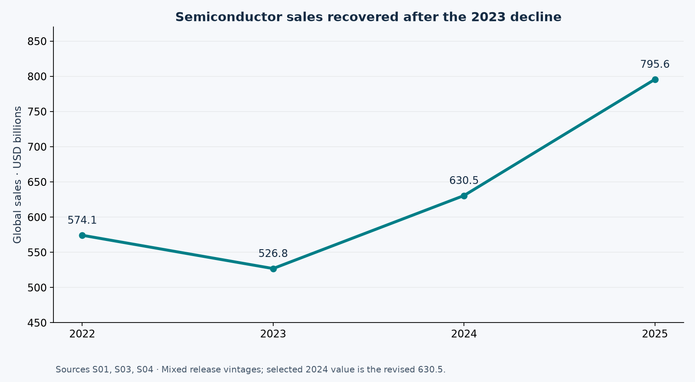
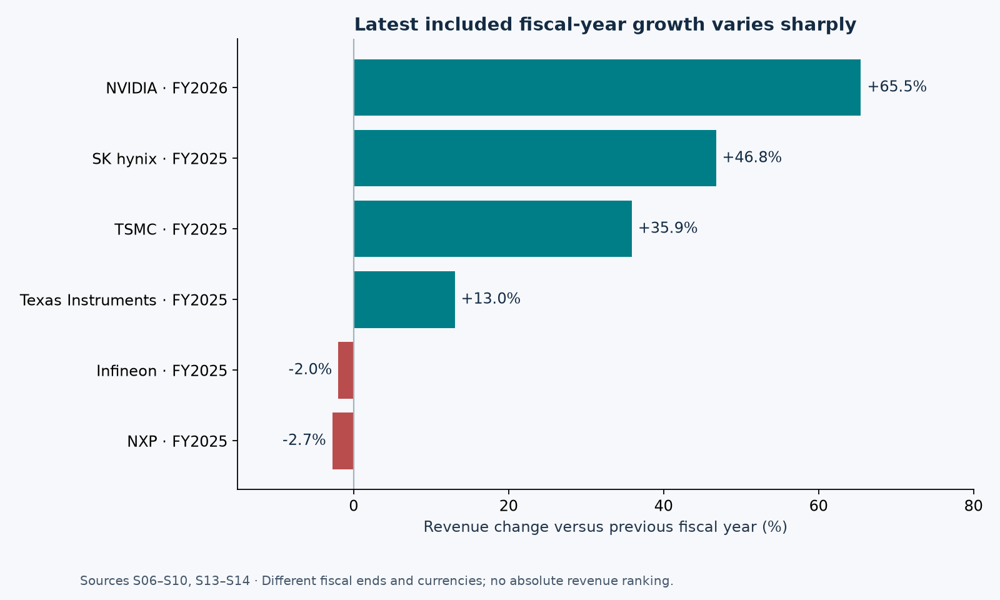
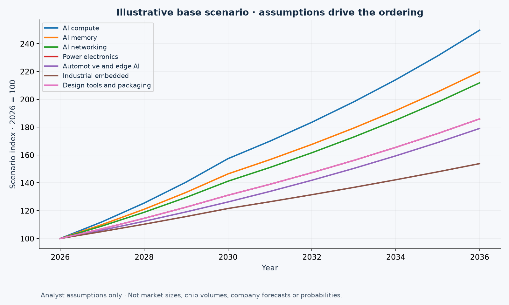
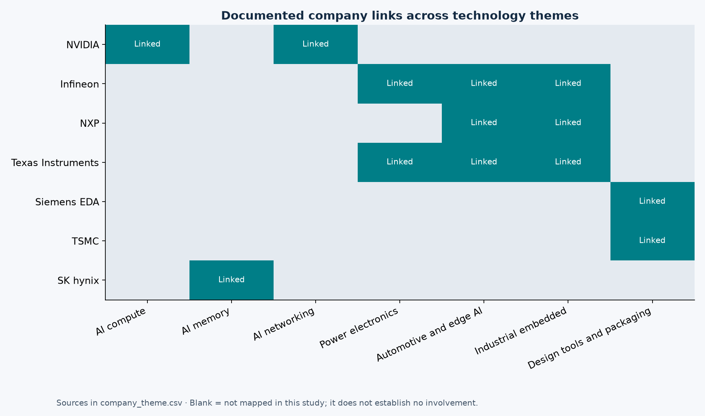

# Semiconductor Demand Outlook 2036

A semiconductor market-intelligence portfolio project built with Python, SQL and Power BI project files. Explore reported results, trace the evidence, and test transparent technology-growth scenarios through 2036.

**Current status:** the numerical pipeline, four Python charts, CSV exports and native Power BI project definitions are built. The report JSON passes Microsoft schema checks. Native Power BI opening, data refresh and visual inspection remain unverified because Desktop is not available in the authoring environment. This is a research prototype, not a validated prediction of a winning company or segment.

## Start here

- [Live review site](https://semiconductor-outlook-2036-review.beefyboar4.chatgpt.site) — private to the project owner; GitHub charts and findings below are publicly readable.

- [Visual overview](reports/overview.html) — download/open locally to view the report in a browser.
- [Findings and interpretation](reports/findings.md).
- [Exploration notebook](notebooks/01_exploration.ipynb).
- [Power BI project](powerbi/Semiconductor-Outlook.pbip) and [opening instructions](powerbi/README.md).
- [Source register](data/processed/sources.csv) and [methodology](docs/methodology.md).

## Business question

Which chip-related technologies could benefit from AI infrastructure, electrification and intelligent systems over the next decade, and how are selected companies connected to those themes?

Companies: NVIDIA, Infineon, NXP, Texas Instruments, Siemens EDA, TSMC and SK hynix.

Themes: AI compute, AI memory, AI networking, power electronics, automotive/edge AI, industrial embedded, and design tools/packaging.

Reported observations, published forecasts and analyst assumptions are distinct data domains. The project does not rank stocks, convert electricity demand into chip revenue, or manufacture market shares from qualitative company links.

## Results at a glance

**Main conclusion:** recent results in the sampled AI compute, memory and foundry businesses support prioritizing the AI infrastructure ecosystem for further research. They do not establish a winning company or chip segment for 2036.

| Result | Evidence | Interpretation |
| --- | --- | --- |
| Market sales recovered | Selected reported sales: USD 526.8bn in 2023, 630.5bn in 2024 and 795.6bn in 2025 | Aggregate recovery; growth varies across products. |
| Company growth differs | Latest included growth: NVIDIA +65.5%, SK hynix +46.8%, TSMC +35.9%, TI +13.0%, Infineon -2.0%, NXP -2.7% | Within-company revenue growth, across different fiscal periods and reported currencies. |
| AI infrastructure has several dependencies | Documented links across compute, memory, networking, power, manufacturing and design | Research the ecosystem rather than treating GPU vendors as the entire opportunity. |
| AI compute has the highest illustrative base index | 2036 index 249.7, with 2026 = 100 | A consequence of assigned rates, not a validated market-demand forecast. |

The 2024 market value uses a later release than the original USD 627.6bn estimate. The audit data preserves both versions. NVIDIA FY2026 ends in January 2026; the other latest included company observations are FY2025. Revenue growth includes price, mix and other effects; it is not chip shipment growth.

See [the complete results](reports/findings.md) for source IDs, all scenario outcomes and the evidence needed before making a ten-year winner claim. Power BI Desktop opening, refresh and visual checks remain an explicit validation gate.

## Reproduce

Python 3.12 or newer is recommended. From this project folder:

~~~sh
git clone https://github.com/suryanshitomar/semiconductor-demand-outlook-2036-Data-Analysis-.git
cd semiconductor-demand-outlook-2036-Data-Analysis-
python -m venv .venv
# Windows PowerShell:
.venv/Scripts/Activate.ps1
# macOS/Linux instead: source .venv/bin/activate
python -m pip install -r requirements.txt
python src/analysis.py
python src/powerbi.py
python -m unittest discover -s tests -v
~~~

The analysis reads the pinned research snapshot and scenario configuration without network access. It generates eight CSV tables, a local SQLite database, four PNG charts, and a findings report. The Power BI builder embeds the same data so imports have no machine-specific paths. Open the PBIP in Desktop and refresh to load its model.

Optional schema validation requires network access on the first run:

~~~sh
python scripts/validate_powerbi.py
~~~

For notebook exploration, install Jupyter in your environment and open notebooks/01_exploration.ipynb. The notebook is supplied without cached output; it reads generated tables.

## Explore with SQL

Open outputs/analysis.sqlite in a SQLite client after building. Run [sql/exploration.sql](sql/exploration.sql) to inspect selected market vintages, within-company growth, 2036 scenario endpoints and missing source references.

## Change a scenario

Edit config/scenarios.json. Early growth applies to 2027–2030; late growth applies to 2031–2036. Each theme/scenario begins at 100 in 2026. Rebuild the analysis and Power BI files, then reopen and refresh Desktop. Conservative/Base/Accelerated are sensitivity cases without assigned probabilities. Themes overlap; do not add their indices.

## Data coverage and limitations

- Snapshot reviewed 5 November 2026: 17 sources, seven companies, 16 company-year revenue observations, four selected market years, and seven themes. This is a small curated research dataset.
- Missing history is not interpolated. The raw market table retains a superseded 2024 release value for traceability.
- Company revenues remain in reported currencies. They are not summed or treated as market share. Siemens group revenue is excluded from semiconductor comparisons.
- Company relevance is a qualitative mapping, not an exposure score. Blank heatmap cells mean not mapped here.
- Published WSTS forecasts stop in 2027 in this snapshot. The 2036 paths are separately labeled assumptions, not extrapolated consensus forecasts.
- Public source documents retain their own rights. They are linked, not bundled. No project reuse license has yet been selected.

## Project structure

~~~text
config/scenarios.json             Editable analyst assumptions
data/raw/research_snapshot.json   Pinned facts, provenance and mappings
data/processed/                  Eight typed CSV exports
src/analysis.py                  Validation, calculations and charts
src/powerbi.py                   Portable Power BI project builder
sql/exploration.sql              Reproducible analytical queries
notebooks/01_exploration.ipynb    Guided EDA
outputs/charts/                  Four reviewed Python charts
reports/                         Visual overview and findings
powerbi/                         Four-page PBIP model and report definitions
tests/                           Meaningful validation and calculation tests
docs/                            Methods, dictionary and validation status
.github/workflows/ci.yml         Rebuild and regression checks
~~~

## Before publishing the finished portfolio

Complete the Power BI Desktop validation checklist in docs/validation.md. Add actual report screenshots and resolve any native compatibility issues. Expand evidence before claiming a 2036 winner. Replace this research status with the validation actually completed. This repository is published as a research prototype; Power BI Desktop validation remains pending.
